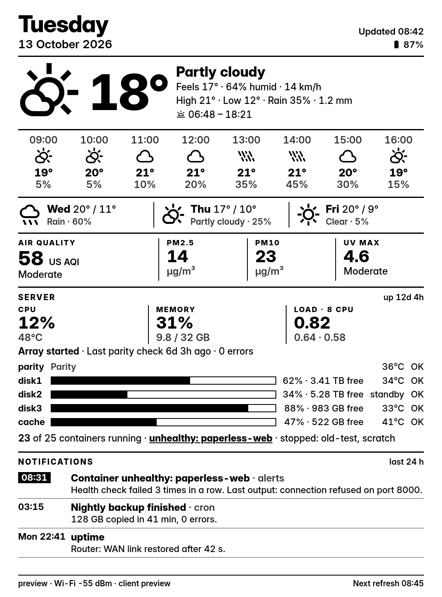
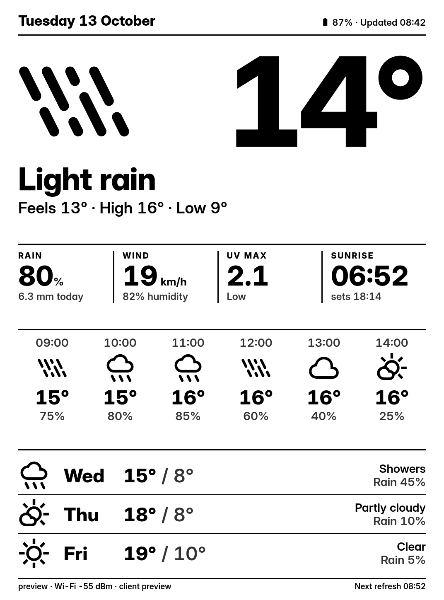
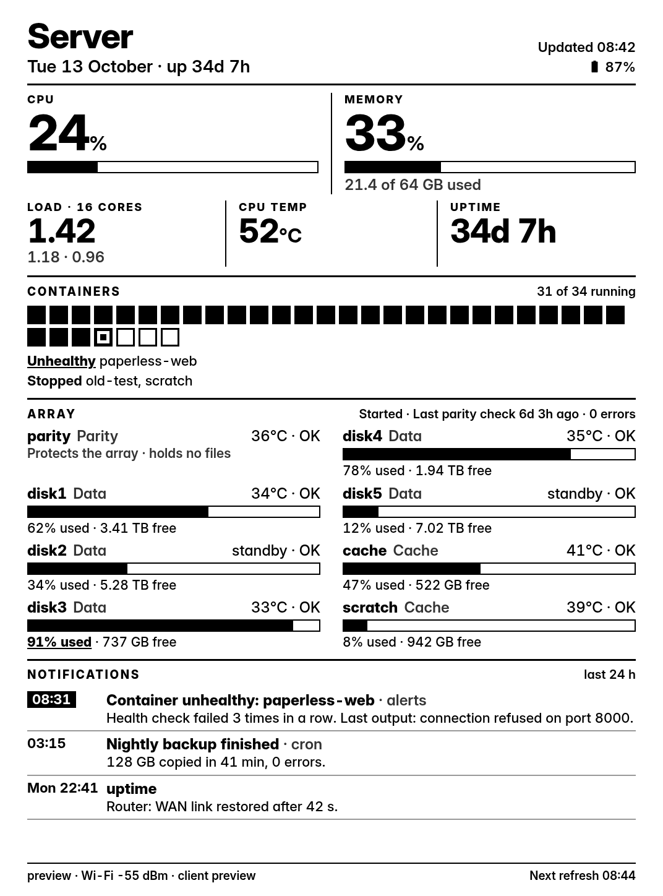
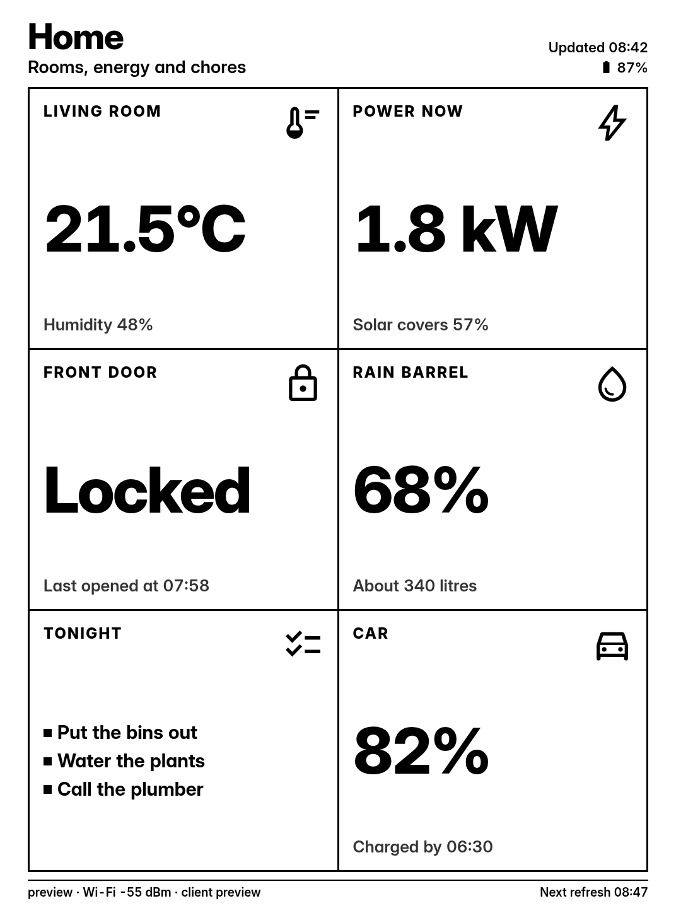
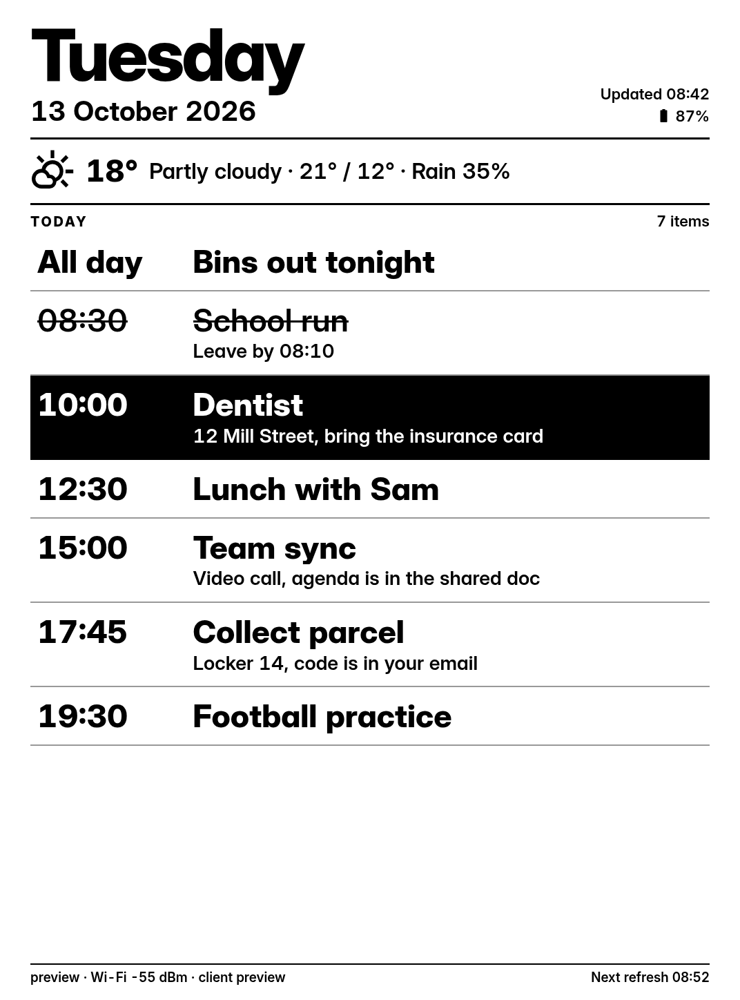
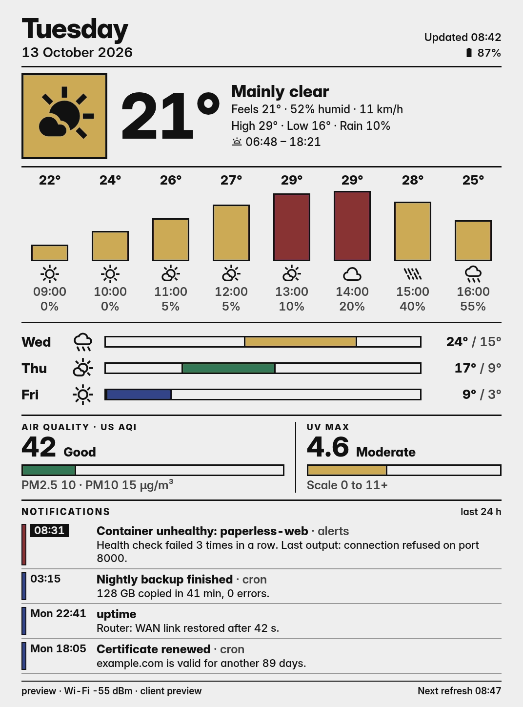
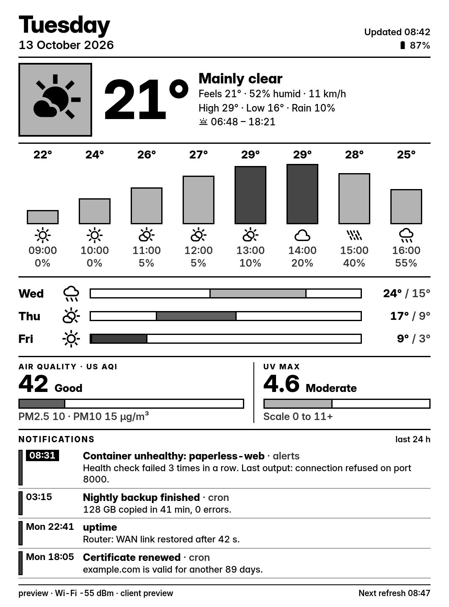
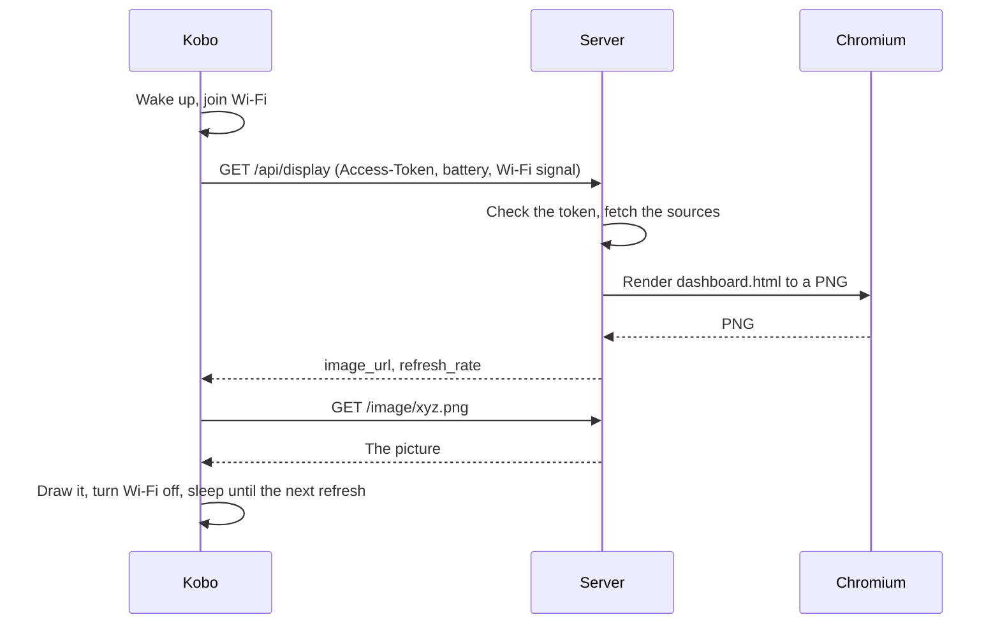

# kobodash

kobodash turns a Kobo e-reader into a wireless e-ink dashboard. A small server you run draws a picture (weather, a calendar, your server's health, anything you can describe in HTML), and the Kobo shows it. Every few minutes the Kobo wakes up, connects to Wi-Fi, fetches a new picture, draws it and goes back to sleep to save battery. You change what it shows on the server, not on the Kobo. Updates to the Kobo's own program also arrive over Wi-Fi, and the Kobo only accepts them if they are signed.

Kobo only, for now. Kindle is not supported.

## What it looks like

These are real renders from the dashboards in this repo, on a Kobo Clara 2E sized screen (1072 x 1448). Each name is the folder in `dashboards/`.

<table>
  <tr>
    <td align="center" valign="top"><br><code>home</code><br>Weather, air quality, server health and alerts in one screen.</td>
    <td align="center" valign="top"><br><code>weather</code><br>A huge temperature you can read across a room.</td>
    <td align="center" valign="top"><br><code>server</code><br>CPU, memory, Docker containers, disks and alerts.</td>
    <td align="center" valign="top"><br><code>cards</code><br>Tiles laid out from a JSON file. No HTML needed.</td>
    <td align="center" valign="top"><br><code>agenda</code><br>Today's date, a forecast line and your agenda from any JSON API.</td>
  </tr>
</table>

Two more folders have no picture here: `color` (the colour design below) and `url` (shows a screenshot of any web page).

### Colour

<table>
  <tr>
    <td align="center" valign="top"><br>The <code>color</code> dashboard as the server renders it.</td>
    <td align="center" valign="top"><br>A rough simulation of how a Kaleido 3 colour screen would show it.</td>
    <td align="center" valign="top"><br>The same design captured from the screen of a black-and-white Kobo Clara 2E.</td>
  </tr>
</table>

The first picture is a normal computer render. The second is only a guess at how a Kaleido 3 colour e-ink screen washes colours out. The third is a real capture from a black-and-white Kobo, which shows the colour design stays readable without colour. kobodash has not been tested on a colour Kobo yet. If you try it, `make setup` turns colour on by itself for the Clara Colour and Libra Colour, so tell us how it goes.

## What you need

- A Kobo. The Kobo Clara 2E is the one it has been tested on. The CLI knows about other models (Clara HD, Clara BW, Libra 2, Sage, Forma and more), but those are untested. The Kobo needs 4.x firmware and about 150 MB free.
- A computer to run the setup, Linux or macOS, with Python 3.9 or newer and `make`.
- Something that stays on to run the dashboard server. Either a machine with Docker (`make serve`), or a computer with Chromium that stays on (`make serve-local`).
- Wi-Fi that both the Kobo and the server are on.

## Quick start

1. Plug the Kobo into your computer with its USB cable. On the Kobo's screen, tap **Connect**. Wait until your computer shows it as a drive. If the Kobo is already showing a dashboard, plugging it in makes it restart into its normal screen, which then asks to connect. That takes about a minute.
2. In this folder, run:

   ```
   make setup
   ```

3. It lists the connected drives and marks the Kobo (your list will look different). Type the number of yours. If your computer shows the Kobo somewhere unusual, run `python3 cli/kobodash.py setup --mount /path/to/the/Kobo` instead.

   ```
   Connected drives:
     1. KOBOeReader   10.5 GB   /media/you/KOBOeReader   <-- a Kobo: Kobo Clara 2E, firmware 4.38.23828
   Which one is your Kobo? Type its number:
   ```

4. Setup says `Found: Kobo Clara 2E, firmware 4.38.23828.` and checks the Kobo (more on that under Safety). On any model other than the Clara 2E it adds `kobodash has only been tested on the Kobo Clara 2E. Yours should work, but it is a guess.` Then it lists what it will change (the next section has the same list). Nothing is written until you type `yes` at this prompt:

   ```
   Type yes to go ahead, or anything else to stop:
   ```

5. Answer a few questions. Press Enter to take the suggestion in brackets. It asks for:
   - the address of the computer that will run the server, for example `192.168.1.50:8737`;
   - a name for this Kobo;
   - your latitude and longitude, for the weather (you can skip this and add `LAT` and `LON` to `.env` later);
   - which dashboard to show, from a numbered list;
   - whether to turn on SSH, which you can say no to.

6. It downloads the pieces it needs and checks each one against a fixed fingerprint, then copies files to the Kobo and writes a `.env` file in this folder (if one already exists it asks before replacing it, and keeps a copy in `.cache/`). The `.env` holds a random token the Kobo and the server share, so keep it private.
7. Eject the Kobo safely in your file manager (Eject in Finder on a Mac), then unplug the cable.
8. The Kobo should restart and install everything by itself, which takes about a minute. If it is still on its home screen after a minute, restart it: hold the power button, choose Power off, then switch it on again.
9. Start the server:

   ```
   make serve
   ```

   Until the server is running, the Kobo shows an error picture. That is fine. Once it is up, the next wake-up draws your dashboard.

If you plan to run the server on a different machine, copy this folder there (with the `.env`) and run `make serve` there. Setup also prints the `.env` lines on screen for that case.

Want to look first? `python3 cli/kobodash.py setup --dry-run` goes through every step, downloads and checks the files, and writes nothing to the Kobo or to `.env`.

The server listens on port 8737. If you have a firewall on that machine, let the Kobo reach that port.

`make stop` stops the Docker server. After you change `.env`, run `make serve` again. Changes to a dashboard folder show up on the next refresh without a restart.

## What setup changes on your Kobo

Setup tells you this before it writes anything:

- It installs NickelMenu, a small menu on your Kobo with a "Start dashboard" entry (skipped if you already have it).
- It installs NiLuJe's kobo-stuff tools, small helper programs the dashboard needs (skipped if you already have them).
- It installs a small startup hook, so that after it starts up your Kobo shows the dashboard instead of the reading screen.
- It copies the dashboard program into a new folder on the Kobo, `.adds/kobodash`.
- It turns off the open servers kobo-stuff would otherwise start: SSH without a password, telnet and FTP. Anyone on your Wi-Fi could get in through those. SSH stays off unless you turn it on, and then it accepts only your key.

Your books, reading settings and Kobo account are not touched. Any file setup replaces is first copied to `.adds/kobodash/backup/`.

After setup, the Kobo is a dashboard, not a normal e-reader, until you go back (next section). Setup also leaves alone any NickelMenu, kobo-stuff, TRMNL client or KOReader it finds already installed.

## Getting back to the normal Kobo

Any of these works, and none needs SSH.

- **Plug it into a computer.** Within about a minute the Kobo restarts into the normal Kobo and asks to connect. Tap **Connect** to work on its files. When you unplug it, the dashboard starts again by itself. A wall charger does not do this; the Kobo just charges.
- **Three failed starts.** If the Kobo starts three times in a row and its program stops before it even asks the server (for example after a broken update), it gives up and stays in the normal Kobo. A server that is off or a wrong Wi-Fi password does not count: the Kobo shows its error picture and keeps trying. Once the problem is fixed, choose "Start dashboard" in NickelMenu to start again.
- **A "disabled" file.** Connect the Kobo and create an empty file named `disabled` in `.adds/kobodash` on it. The Kobo stays normal until you delete that file.
- **Remove it for good.** Connect the Kobo and run `make uninstall`. Type `yes`. Eject and unplug; when the Kobo restarts it removes the startup hook (and NickelMenu, if kobodash installed it). If it does not restart within a minute, switch it off and on again. When its normal screen is back, connect it again and run `make uninstall` a second time to delete the leftover `.adds/kobodash` folder and the menu entry. kobo-stuff stays installed, which is harmless now that its servers are off. Your books and settings are not touched.

A Kobo on a charger never sleeps: it stays awake with Wi-Fi on and refreshes on schedule. On battery it sleeps between refreshes. While the dashboard runs, the touchscreen does nothing and the power button only wakes the Kobo for an early refresh.

## Make your own dashboard

A dashboard is a folder in `dashboards/`. The quickest way to start is to copy one:

```
cp -r dashboards/agenda dashboards/mine
```

Then:

1. Edit `dashboards/mine/dashboard.json`, which says where the data comes from.
2. Edit `dashboards/mine/dashboard.html`, which says how it looks.
3. Put sample data in `dashboards/mine/sample.json`, one entry per source, in the shape that source returns. The preview uses it, so it works without any network.
4. Set `DASHBOARD=mine` in `.env`, then run `make serve` again.

To see the result without a Kobo:

```
make preview DASHBOARD=mine
```

That writes `preview.png` in this folder. Open it and look. Run `make preview` with no name to see `home`.

### The sources

Each entry under `sources` becomes `src.<name>` in your HTML. A source is either a built-in or any JSON API.

| Source | What you get |
| --- | --- |
| `{"builtin": "weather"}` | Current weather, today, the next hours and days, from Open-Meteo. Uses `LAT` and `LON` (or `"lat"` and `"lon"` in the source). |
| `{"builtin": "air"}` | Air quality: `index`, `aqi`, `label`, `pm25`, `pm10`. Same location. With `AQI_INDEX=malaysia` (or `"index": "malaysia"` in the source) the number is Malaysia's Air Pollutant Index from the nearest Department of Environment station, and `station` and `hour` say which reading it is. |
| `{"builtin": "host"}` | The server's CPU, temperature, load, uptime and memory. |
| `{"builtin": "unraid"}` | Array, parity and disk status. Unraid only. |
| `{"builtin": "docker", "url": "..."}` | Containers running, stopped, unhealthy. Needs a Docker API at `url` (see `docker-compose.yml` for a read-only one). |
| `{"builtin": "ntfy", "url": "...", "topics": "...", "token": "..."}` | The newest 5 ntfy messages from the last 24 hours. |
| `{"url": "https://...", "headers": {...}, "cache": 300}` | Any JSON API. The server fetches it with GET and keeps the last good answer if a later fetch fails. `cache` is seconds between fetches. |

Write `${NAME}` anywhere in a string in `dashboard.json` and the server fills it in from your `.env`. A source whose `${NAME}` is empty is skipped quietly, so a dashboard can have optional panels.

If one source fails, the others still draw. The failed one is `None` in `src`, and a short message appears in `errors`.

### A complete tiny example

`dashboards/todo/dashboard.json`:

```json
{
  "name": "Todo",
  "description": "My to-do list, read from my own server.",
  "type": "html",
  "refresh": 300,
  "sources": {
    "todo": {"url": "https://api.example.com/todo", "headers": {"Authorization": "Bearer ${TODO_TOKEN}"}, "cache": 300}
  }
}
```

`dashboards/todo/dashboard.html`:

```html
<!doctype html>
<style>
@font-face { font-family: Inter; src: url("{{ font_dir }}/InterVariable.ttf"); font-weight: 100 900; }
body { margin: 40px; background: #fff; color: #000; font: 800 56px/1.4 Inter, sans-serif; }
h1 { font-size: 90px; margin: 0; }
</style>
<h1>To do</h1>
<div>{{ item }}</div>
<p>{{ errors.get('todo') }}</p>
```

`dashboards/todo/sample.json`:

```json
{"todo": {"items": ["Buy milk", "Call Sam", "Water the plants"]}}
```

Put `TODO_TOKEN=your-api-token` in `.env`, set `DASHBOARD=todo`, and run `make serve` again.

### What your HTML can use

The page is a Jinja2 template. These names are available:

| Name | What it is |
| --- | --- |
| `src` | The sources, by name. `None` for one that failed or is not set up. |
| `errors` | Short messages, only for sources that failed. Read it with `errors.get('todo')`, because `errors.todo` stops the render when nothing failed. |
| `now` | The current time in your `TZ`, for example `now.strftime('%H:%M')`. |
| `next` | When the next refresh is due (`now` plus the refresh time). |
| `device` | The Kobo that asked: `device.battery`, `device.charging`, `device.rssi`, `device.id`, `device.fw`. |
| `screen` | `screen.width`, `screen.height` and `screen.color`. |
| `font_dir` | A folder holding `InterVariable.ttf` and `MaterialSymbolsOutlined.ttf` for `@font-face`, as in the example. |

Load fonts from `font_dir`, as in the example, instead of linking to a web font. A name your template uses that does not exist stops the render: the Kobo shows an error picture and the server log says why. Run `make preview` before you trust a change.

### E-ink tips

- Black on white. Light grey text nearly vanishes on e-ink.
- Heavy weights (600 to 800) and big numbers. Thin strokes break up.
- Make the one thing you care about huge, and everything else secondary.
- Avoid animation and gradients. Every refresh is a full redraw, so quiet, static layouts look best.
- Use `screen.width` if you want your layout to scale to other Kobo sizes. The built-in dashboards do.

### No HTML: the `cards` dashboard

Set `DASHBOARD=cards` and `CARDS_URL` to any address that returns JSON like this, and the server lays out the tiles for you:

```json
{
  "title": "Home",
  "subtitle": "Rooms and chores",
  "cards": [
    {"title": "Living room", "value": "21.5°C", "note": "Humidity 48%", "icon": "thermostat"},
    {"title": "Front door", "value": "Locked", "note": "Last opened at 07:58", "icon": "lock"},
    {"title": "Tonight", "icon": "checklist", "items": ["Put the bins out", "Water the plants"]}
  ]
}
```

Only `title` is needed on a card. `value` is the big text, `note` a line under it, `icon` a [Material Symbols](https://fonts.google.com/icons) name, and `items` short lines below. Two to nine cards look best; the first 12 are shown. `subtitle` is optional.

### No HTML: the `url` dashboard

Set `DASHBOARD=url` and `DASHBOARD_URL` to the page you want, for example your Home Assistant or Grafana dashboard. The server takes a screenshot of it at the Kobo's screen size and sends that. It waits 5 seconds first (change `wait` in `dashboards/url/dashboard.json`). The server opens the page like a fresh browser with no login, so it has to be viewable without signing in.

## Settings

`make setup` writes most of these into `.env`. `.env.example` lists every setting with comments.

| Variable | What it does |
| --- | --- |
| `KOBODASH_TOKEN` | The secret the Kobo sends with each request. The server answers 401 without it. |
| `OTA_KEY` | Signs updates to the Kobo's program. Empty means no updates are offered. |
| `DASHBOARD` | Which folder of `dashboards/` to show. Default `home`. |
| `PUBLIC_URL` | How the Kobo reaches the server, like `http://192.168.1.50:8737`. |
| `TZ` | Your time zone, like `Europe/London`. |
| `LAT`, `LON` | Where you are, for weather and air quality. |
| `AQI_INDEX` | `us` (default) for the US AQI, or `malaysia` for Malaysia's Air Pollutant Index (API) from the Department of Environment. |
| `REFRESH` | Seconds between updates. Default 180. A `refresh` in `dashboard.json` wins. |
| `SCREEN`, `COLOR` | Screen size, like `1072x1448`, and `0` for a black-and-white screen or `1` for colour. Setup fills these in from your model. |

Some dashboards read their own settings: `agenda` uses `AGENDA_URL`, `cards` uses `CARDS_URL`, `url` uses `DASHBOARD_URL`, and the dashboards with notifications use `NTFY_URL`, `NTFY_TOPICS` and `NTFY_TOKEN`. `home` and `server` use `DOCKER_URL` for the Docker panel. Leave them out and that panel stays empty.

`make serve` and `make serve-local` both read `.env`.

## How it works



The server draws a new picture when the Kobo asks, not on a timer. It renders your HTML in headless Chromium and hands the screenshot over under a random address. The Kobo turns it into shades of grey itself.

The Kobo sends its token on every request, and the server refuses anything without the right one. The token travels over your home network in plain HTTP, so treat this as a home setup, not something to expose to the internet.

Updates to the Kobo's program work differently. The Kobo reports its version. If it differs from `device/client/version.txt`, the server offers a download together with an HMAC-SHA256 signature made with `OTA_KEY`. The Kobo has its own copy of that key from setup, which never crosses the network. It checks the signature, checks that every script parses, installs, and restarts. Someone else on your Wi-Fi who knows the token still cannot push code to your Kobo.

If you change files in `device/client/`, change `device/client/version.txt` too, or the Kobo will not update.

## Safety

Before it writes anything to your Kobo, setup checks:

- The Kobo is identified from its `.kobo/version` file. A model it does not know is refused unless you type an override phrase, and then it assumes a 1072 x 1448 black-and-white screen.
- The firmware is 4.x.
- No software update is already waiting (`.kobo/KoboRoot.tgz`). A Kobo installs only one at a time.
- The Kobo is writable and has about 150 MB free.
- Every download (NickelMenu, kobo-stuff and the Kobo client files) matches a sha256 pinned in `cli/pins.json`, fetched from one fixed commit of usetrmnl/trmnl-kobo. Any mismatch stops setup before the Kobo is touched.

kobo-stuff normally starts SSH with no password check, telnet as root and a writable FTP server. kobodash switches all three off at every start. SSH is optional, and when you turn it on it only accepts the key you picked.

## Credits and licences

kobodash is MIT licensed (see `LICENSE`).

The Kobo client is based on [usetrmnl/trmnl-kobo](https://github.com/usetrmnl/trmnl-kobo) (MIT, copyright TRMNL). Its licence is in `device/client/LICENSE.trmnl`. The tools that come with it (FBInk, BusyBox, LuaJIT) keep their own licences.

[NickelMenu](https://github.com/pgaskin/NickelMenu) by pgaskin and kobo-stuff by NiLuJe are downloaded when you run setup (from a pinned commit of usetrmnl/trmnl-kobo, which carries the upstream releases). They are not part of this repo and keep their own licences. kobo-stuff includes GPL software.

The fonts are Inter (SIL Open Font Licence) and Material Symbols (Apache 2.0). They are downloaded on first run and checked against pinned checksums. The Docker image fetches them while it builds.

## Development

```
make test
make preview DASHBOARD=home
```

`make test` runs the unit tests in `tests/` and sets up `.venv` the first time. `make preview` renders a dashboard with its `sample.json` to `preview.png`. To preview a different screen, call the server directly, for example `.venv/bin/python server/kobodash.py --preview home --sample --screen 1264x1680 --color`.
